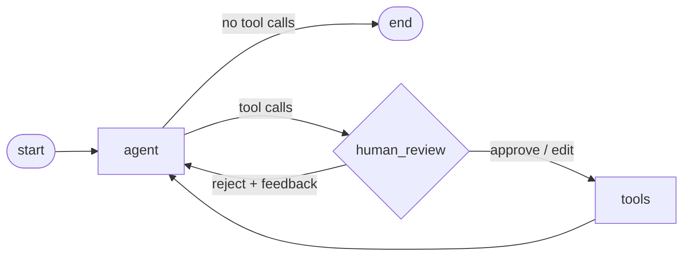

# Kaggle Baseline Agent

A LangGraph agent that turns a plain-English request into a trained baseline ML model, **with a human approving the important decisions**.

> "Find a house prices dataset and build a baseline model to predict the sale price."

The agent finds a dataset on Kaggle, downloads it, inspects the columns, picks a target, trains three scikit-learn baselines and reports the metrics. It pauses twice for a person to approve, edit or reject what it is about to do.

<!-- Add a screenshot or GIF of the approval flow here: docs/demo.gif -->

## How it works



| Tool | Needs approval? | What it does |
|---|---|---|
| `search_datasets` | no | Lists the top 5 Kaggle datasets for a query |
| `download_dataset` | **yes** | Checks the size limit, downloads, lists the tabular files |
| `inspect_file` | no | Shape, column types, missing %, sample rows |
| `train_baselines` | **yes** | Trains a dummy model, a linear model and a random forest, saves the best |

- **The LLM decides *what* to do; plain Python does the work.** The model picks the dataset and the target column. Preprocessing, splitting, training and metrics are deterministic scikit-learn code (`app/ml.py`), so the same input always gives the same numbers.
- **Human in the loop** uses LangGraph's `interrupt()`. The graph pauses and saves its state under a `thread_id`. The person can **approve**, **edit** the arguments (for example change the target column) or **reject with feedback**, which the agent reads and adapts to.
- **A Dummy baseline is always trained,** so every result answers "does the model beat guessing?".

### Guardrails

All checks are plain Python in `app/guardrails.py`. They run outside the LLM, so the model cannot talk its way past them.

| Layer | Check |
|---|---|
| User input | Not empty, length limit, regex for obvious prompt injection (returns HTTP 400) |
| Tool arguments | Dataset ref must look like `owner/dataset`; file paths cannot escape the dataset folder |
| Resources | Download size limit; large tables are sampled to a row limit |
| ML sanity | Target column exists; enough rows; classification has at least 2 classes |
| Loop | Graph recursion limit stops a looping agent |
| Scope | The system prompt tells the model to decline off-topic requests |

Tools never raise to the LLM. Every error comes back as a readable string, so the agent can recover.

## Project layout

```
app/
  config.py         settings from environment variables
  guardrails.py     safety checks
  kaggle_client.py  search / find / download (thin Kaggle wrapper)
  ml.py             load table, preprocess, train and evaluate baselines
  tools.py          the four @tool functions the LLM can call
  state.py          graph state
  agent.py          the LangGraph graph with the human review step
  api.py            FastAPI: /chat, /chat/{thread_id}/resume, /runs/{run_id}
ui/streamlit_app.py chat UI with the approval panel
evals/              task list and the evaluation runner
tests/              offline tests (fake LLM, fake Kaggle)
```

Each file only imports from files listed above it, so the code can be read top to bottom.

## Run it

You need Python 3.12, [uv](https://docs.astral.sh/uv/), a [Groq API key](https://console.groq.com) and a Kaggle API token saved as `~/.kaggle/kaggle.json`.

```bash
git clone https://github.com/bigyan08/kaggle_agent.git
cd kaggle_agent
uv sync
cp .env.example .env        # then put your GROQ_API_KEY in .env

uv run uvicorn app.api:app --reload        # API:  http://localhost:8000/docs
uv run streamlit run ui/streamlit_app.py   # UI:   http://localhost:8501
```

With Docker (needs `.env` and `~/.kaggle/kaggle.json` to exist):

```bash
docker compose up --build                  # UI: http://localhost:8501
```

### Configuration

| Variable | Default | Meaning |
|---|---|---|
| `AGENT_MODEL` | `groq:openai/gpt-oss-120b` | `provider:model-id`. To switch provider, change this and `uv add` that provider's LangChain package (for example `langchain-anthropic`) |
| `MAX_DOWNLOAD_MB` | 200 | Largest dataset the agent may download |
| `MAX_ROWS` / `MIN_ROWS` | 50000 / 50 | Rows sampled for training / minimum needed |
| `MAX_INPUT_CHARS` | 1000 | Longest accepted user message |
| `RECURSION_LIMIT` | 25 | Maximum graph steps per request |
| `LANGSMITH_API_KEY` | unset | Optional, for tracing |

## Tests

```bash
uv run pytest        # 38 tests, offline, no API keys needed
```

The agent tests use a scripted fake LLM, so approve, edit and reject flows are tested without a network. ML tests use scikit-learn's built-in iris and diabetes data.

## Evaluation

`uv run python -m evals.run_evals` runs the real agent (real LLM, real Kaggle) on 10 tasks, approving every pause automatically: 6 classification and 4 regression prompts such as "Find the Titanic dataset and predict who survived".

| Metric | Result (10 tasks) |
|---|---|
| Trained a model | 100% |
| Task type correct | 100% |
| Best model beats the Dummy | 100% |
| Average tool calls | 4.3 |
| Average time per task | 31 s |

Per-task numbers are in [`evals/results.json`](evals/results.json).

**What this does and doesn't show.** It shows the whole pipeline (search, download, inspect, train) works end to end on varied, well-known datasets. It does *not* check that the agent chose the right dataset or target column, it approves everything automatically (so edit and reject are only covered by the unit tests), and 100% on easy prompts is a smoke test, not a benchmark.

## Design decisions

- **Two approval points, not one.** Downloading uses bandwidth and disk; choosing the target column is the decision that most changes the result. Cheap read-only tools run without asking.
- **Deterministic ML.** Letting an LLM write training code would make results unreproducible and unsafe to run. Here the model only chooses arguments.
- **Plain-Python guardrails.** They are simple to read, test and reason about. An LLM-based classifier could be added later for input checks.
- **In-memory checkpointer.** `MemorySaver` keeps the code small; pending approvals are lost on restart.
- **Small, readable code.** About 700 lines in total, functions kept short, no abstraction layers.

## Limitations and next steps

- Only tabular data, only scikit-learn baselines, no hyperparameter tuning.
- State is in memory. A SQLite or Postgres checkpointer would survive restarts and allow several workers.
- No authentication; the API is meant for local use or a trusted network.
- The Kaggle client works around a missing `User-Agent` header bug in `kaggle` 1.8.2 (see `app/kaggle_client.py`); remove it once a fixed release is available.
- Stronger evals: expected target columns per task, harder and vaguer prompts, off-topic and prompt-injection cases, and measuring cost per run.
